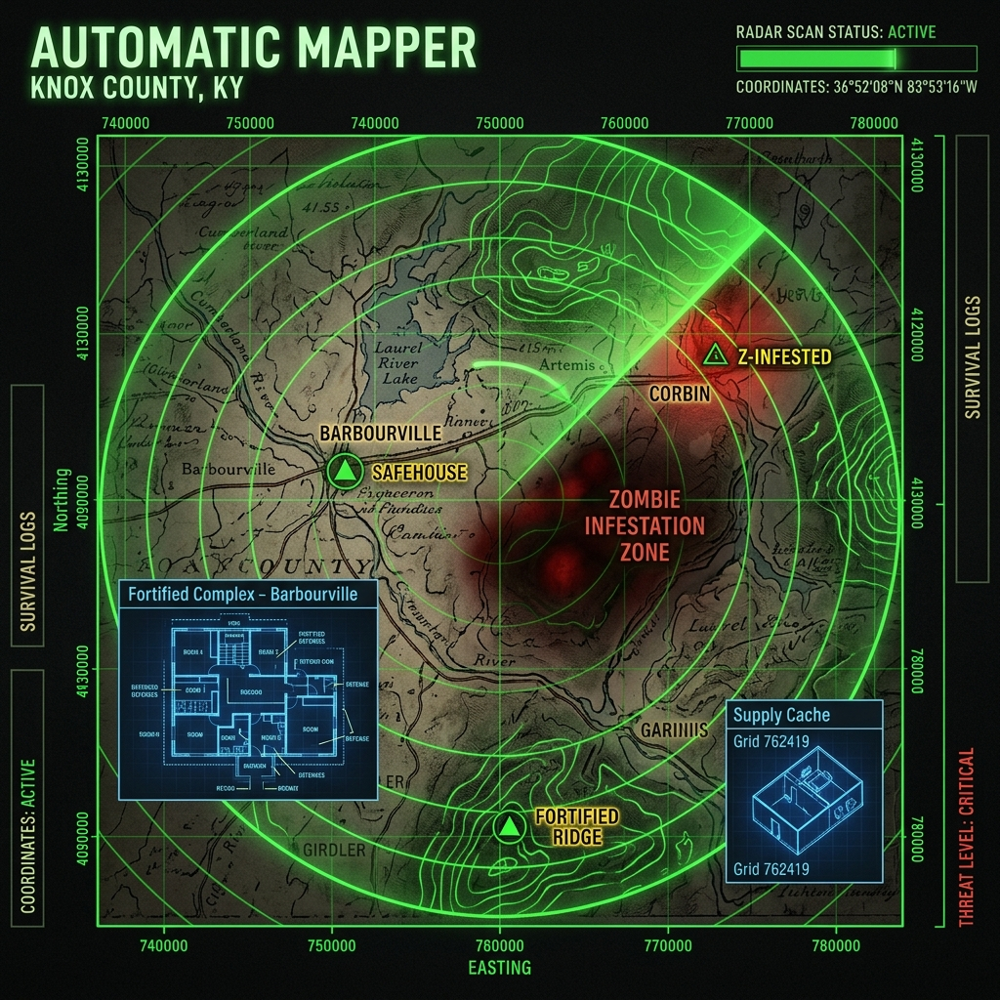

# AutomaticMapper — Knox Spatial Extractor (Build 42)

> **Mapeador automatizado y extractor espacial para Project Zomboid (Build 42).**  
> Diseñado para resistir actualizaciones del juego, generar bases de datos ultracompactas con índices espaciales, y clasificar casas, habitaciones interiores, carreteras, zonas urbanas, infraestructura y objetos físicos (alcantarillas, contenedores, etc.).



---

## 1. Nuevas Opciones de Inspección y Extracción

Tanto en la herramienta de consola como en el Mod visual dentro del juego, se han incorporado las **3 nuevas opciones ampliadas**:

1. **Identificación de Habitaciones y Locales Comerciales:** Extrae la definición de locales interiores (`RoomDef`) directamente desde los archivos binarios de celda (`.lotheader`) y SQLite:
   - Detecta si la coordenada está dentro de un local específico: **Biblioteca / Librería (`library`)**, **Dentista (`dentist`)**, **Tienda de Electrónica (`electronicsstore`)**, **Restaurante (`restaurantdining`)**, **Tienda de Ropa (`clothesstore`)**, etc.
   - Informa los límites exactos del local en tiles (`X=min..max, Y=min..max`), sus dimensiones y su planta/nivel Z.
   - Detecta automáticamente los **locales contiguos dentro del mismo complejo comercial**.
2. **Incluir Objetos:** Identifica y cataloga la infraestructura y elementos físicos presentes en el sector:
   - Tapas de alcantarilla / Manholes (`street_decoration_01_8 / 9 / 10`, `location_sewer_...`)
   - Mobiliario comercial: Libreros, estanterías (`furniture_shelving_...`), mostradores, cajas registradoras
   - Pintura vial y líneas de tráfico (`street_trafficlines_...`)
   - Bordillos y cordón cuneta (`street_curbs_...`)
   - Contenedores, cajas y muebles de guardado
   - Puertas, ventanas y generadores
3. **Incluir Rutas Cercanas:** Encuentra todas las carreteras y calles dentro de un radio configurable en tiles (por defecto `35` tiles), indicando distancia exacta y dirección cardinal.
4. **Incluir Casas / Edificios Cercanos:** Encuentra todas las propiedades, residencias y tiendas dentro del radio en tiles, indicando distancia exacta, categoría (`Residential`, `Commercial`, `Industrial`) y estilo/tono (`HouseSuburb`, `Farmhouse`, etc.).
5. **Detección de Cuerpos de Agua y Ríos:** Identifica si el tile cae dentro de ríos o lagos navegables/pescables (`water_bodies`), reportando polígonos y distancia a la orilla.

---

## 2. Herramientas y Modos de Uso

### A. Inspector Profundo de Tiles (`tools/tile_inspector.py`)

Acepta tanto coordenadas individuales como URLs o cadenas directas del mapa web de Project Zomboid (ej. `#451x9794x2560` o `#418x9811`):

```bash
# Inspección integral detectando el local exacto (ej. Biblioteca en 451x9794):
python tools/tile_inspector.py 451x9794x2560

# Inspección de esquina de calle (ej. Hutchins Dr en 418x9811):
python tools/tile_inspector.py 418x9811
```

#### Ejemplo de Salida:
```text
================================================================================
 ANALISIS INTEGRAL DE TILE: X = 303.0, Y = 9851.0 | Zoom: 2560 (Radio: 35.0 tiles)
================================================================================

[1. COBERTURA EN ESTE TILE EXACTO]
  * Calle actual: Hutchins Dr (Ancho: 6.0 tiles)
    Figura: rect_vertical -> Rectángulo de (302, 9822) a (308, 9891)
  * Zona: Nav (Calzada vehicular)

[2. OBJETOS E INFRAESTRUCTURA DETECTADA EN EL SECTOR]
  * [Tapa de alcantarilla / Manhole] -> Sprite: street_decoration_01_8
  * [Tapa de alcantarilla / Manhole] -> Sprite: street_decoration_01_9
  * [Tapa de alcantarilla / Manhole] -> Sprite: location_sewer_01_36

[3. RUTAS Y CARRETERAS CERCANAS (Radio 35.0 tiles)]
  * Hutchins Dr (Ancho: 6.0 tiles) -> En el mismo tile
  * Highway (secondary) (Ancho: 6.0 tiles) -> En el mismo tile

[4. CASAS Y EDIFICIOS CERCANOS (Radio 35.0 tiles)]
  * bld_resi_319_9850 [Residential | HouseSuburb]
    Distancia: a 11.0 tiles hacia el Este (Caja: [314.0, 9846.0, 324.0, 9854.0])
  * bld_resi_325_9873 [Residential | HouseMedium]
    Distancia: a 24.1 tiles hacia el Sureste
  * bld_resi_328_9877 [Residential | HouseMedium]
    Distancia: a 27.6 tiles hacia el Sureste
  * bld_resi_323_9823 [Residential | HouseSuburbGarage]
    Distancia: a 28.8 tiles hacia el Noreste
  * bld_resi_280_9814 [Residential | Farmhouse]
    Distancia: a 31.9 tiles hacia el Noroeste
================================================================================
```

---

### B. Mod In-Game en Lua (Para Project Zomboid)

La ventana visual del juego ahora incluye las casillas de verificación directas:
* `[x] Ignorar bosques de relleno (compactar envolvente)`
* `[x] Incluir objetos (alcantarillas, contenedores, muebles)`
* `[x] Incluir rutas y carreteras cercanas`
* `[x] Incluir casas y edificios cercanos`
* `[x] Extraer habitaciones y rectángulos interiores`
* **Radio de proximidad:** Caja de texto editable (ej. `35` tiles).

Haz **clic derecho en el mundo** -> **`Abrir AutomaticMapper`** -> Pulsa **`INICIAR ESCANEO Y EXPORTAR`**.
